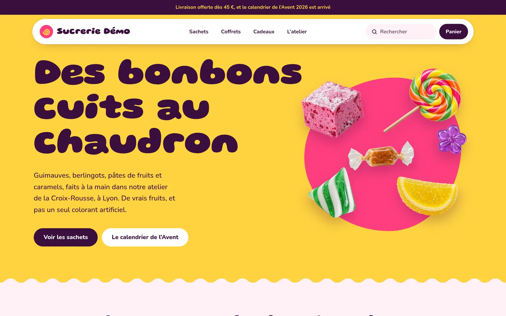
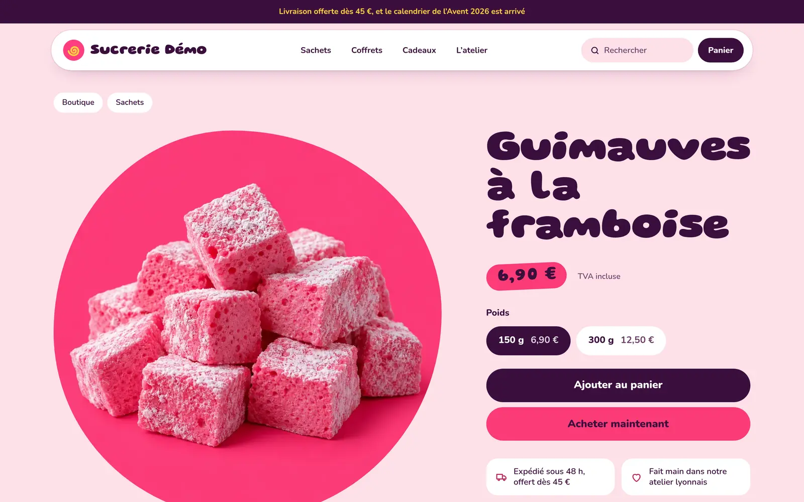
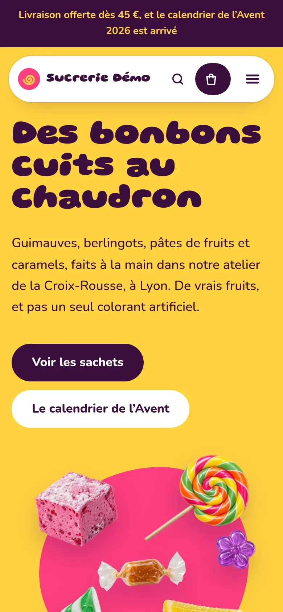

# Sucrerie Démo

Boutique de démonstration d'une confiserie artisanale lyonnaise : guimauves,
berlingots, pâtes de fruits, caramels, coffrets et calendrier de l'Avent. Elle
existe pour montrer qu'un même socle,
[minshop-platform](https://github.com/DamienGR/minshop-platform), n'impose
aucun style : le panier, le paiement, les stocks et l'administration sont ceux
du socle, exactement comme dans
[Maison Démo](https://github.com/DamienGR/shop-maison-demo), sa sœur sobre et
tirée au cordeau ; tout ce que l'on voit est propre à la boutique.



| | |
| --- | --- |
|  |  |

## Ce que montre la démonstration

- **Un thème sans angle droit**, `src/themes/sucrerie-demo/` : des bandes de
  couleur saturée séparées par des coutures ondulées, des photos découpées en
  galets, des pilules, des pastilles, et deux caractères ronds (Gluten pour les
  titres, Nunito pour le texte).
- **Une couleur par bonbon** : chaque produit est photographié sur un fond de sa
  couleur, et la boutique la reprend partout où il apparaît. Sur sa fiche, la
  page entière prend sa teinte (`src/themes/sucrerie-demo/candy.ts`).
- **Un accueil animé, une seule fois** : le titre « gonfle » grâce à l'axe de
  graisse de sa police, et les bonbons tombent en rebondissant. Rien ne bouge
  pour qui a demandé moins d'animations.
- **Un catalogue court mais réel** : 15 produits, 26 unités vendues (poids et
  lots), 30 photographies, 3 rayons, avec ingrédients et allergènes sur chaque
  fiche.
- **Neuf pages** : l'atelier, les ingrédients et allergènes, la livraison, une
  FAQ, le contact et les quatre pages légales.
- **Le parcours d'achat complet du socle** : panier latéral, acceptation des
  CGV, livraison offerte dès 45 €, paiement de démonstration sans débit,
  confirmation avec la TVA, et un historique de commandes fictives pour
  l'administration.

Tout est fictif : la société, ses coordonnées, ses clients. Les photographies
ont été générées pour cette démonstration.

## Essayer en local

```sh
nvm use 22
npm ci && npm ci --prefix mcp
npm run db:migrate
node client/demo/seed.mjs
npm run dev
```

Ouvrez <http://localhost:4321>, créez le mot de passe d'administration sur
`/admin/setup`, puis, si vous voulez un historique de commandes :

```sh
node client/demo/orders.mjs http://localhost:4321
```

## Mettre en ligne

La procédure pas à pas, de la connexion à Cloudflare jusqu'à la vérification,
est dans [`client/demo/MISE-EN-LIGNE.md`](demo/MISE-EN-LIGNE.md). Le détail des
contenus et des scripts de chargement est dans
[`client/demo/README.md`](demo/README.md).

## Le socle

Cette boutique est un clone du tag `v0.3.6` de minshop-platform, avec son
historique : elle reçoit les versions suivantes du socle par fusion
(`npm run shopctl -- core upgrade`). La documentation du socle reste dans le
[README racine](../README.md), [`AGENTS.md`](../AGENTS.md) et
[`CUSTOMIZING.md`](../CUSTOMIZING.md).
